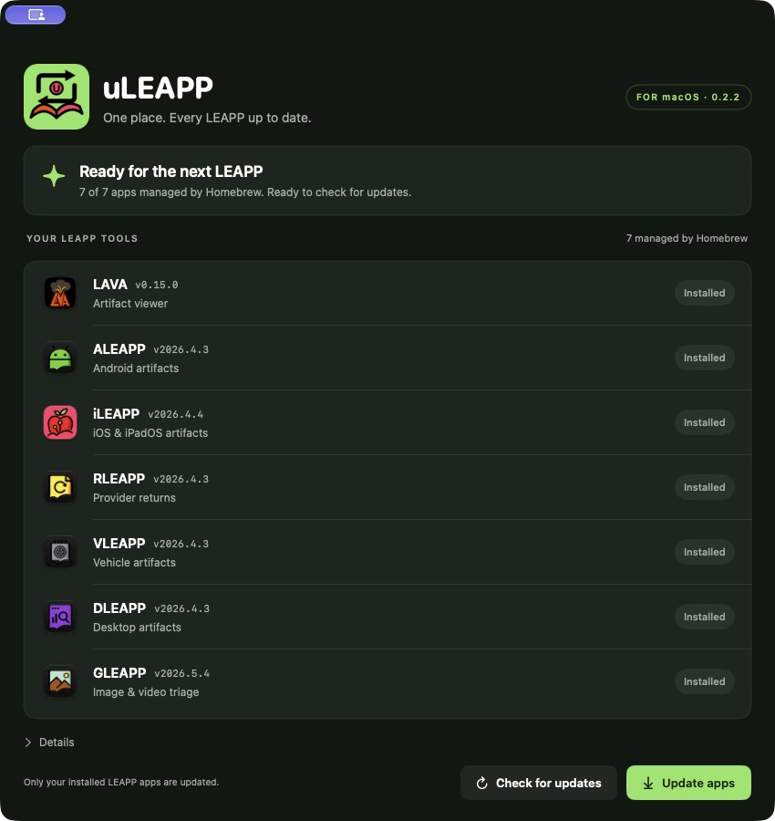
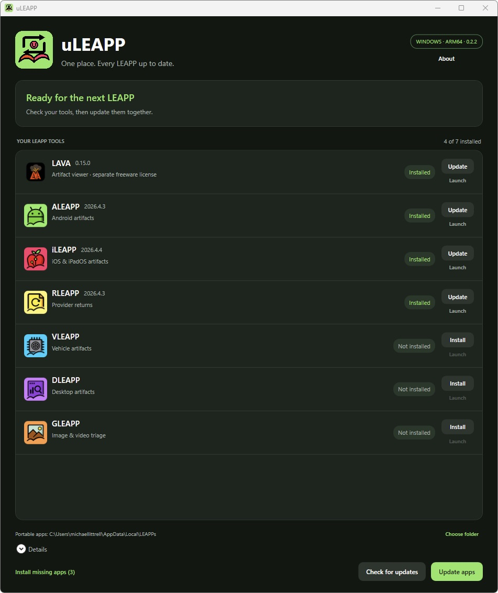

# uLEAPP — LEAPP Installer/Updater

Idea by [@CyberMike81](https://github.com/CyberMike81).

uLEAPP gives the LEAPP family one desktop interface for installing missing apps,
checking versions and updating installed apps. It started as a script to run the
official Homebrew commands and grew into native Mac and Windows GUI apps.

**Community preview 0.3.7 — available for testing and feedback.** This is a
community project; publisher endorsement and inclusion on leapps.org are decisions
for the LEAPP maintainers. No upstream pull request is required to try these builds.

## What it does

- Supports LAVA, ALEAPP, iLEAPP, RLEAPP, VLEAPP, DLEAPP and GLEAPP.
- Detects installed tools and shows their versions and update status.
- Installs a missing tool individually, or installs missing tools together.
- Checks official releases and updates installed tools together.
- Shows progress, per-app results and readable logs. Current apps have no Update button.
- Starts installation/update actions when you choose them; launch checks only uLEAPP release metadata, without downloading app packages.
- Uses the official Homebrew tap on Mac and official GitHub releases on Windows.
- Verifies Windows download size and SHA-256 before installation; portable updates
  keep older versions and their files. Mac and Windows also provide Launch buttons.

Batch LEAPP and GLEAPP Map Downloader are not included. No LEAPP application
executables or installers are bundled with uLEAPP.

## Download and run

Download the matching ZIP from the [0.3.7 preview release](https://github.com/CyberMike81/uLEAPP/releases/tag/v0.3.7),
extract the complete folder, and open its app. Keep the included license/notices files.

| Platform | Download / repository folder | Requirements |
| --- | --- | --- |
| macOS | `uLEAPP-0.3.7-macOS.zip` / `macOS/uLEAPP.app` | macOS 13+; Homebrew installed; universal Apple silicon/Intel build |
| Windows ARM64 | `uLEAPP-0.3.7-Windows-ARM64.zip` / `Windows-ARM64/uLEAPP.exe` | Windows 11 ARM; .NET runtime included |
| Windows x64 | `uLEAPP-0.3.7-Windows-x64.zip` / `Windows-x64/uLEAPP.exe` | Intel/AMD Windows; .NET runtime included |

Close LEAPP tools before updating. Mac can adopt matching manually installed apps
into Homebrew without forcing replacement. Windows setup-installed tools keep
using their publisher's interactive setup; other tools use portable version folders.
LAVA exposes its separate freeware terms before first installation.

LAVA 0.15.0 uses its official x64 setup on Windows ARM after the native ARM setup
left missing files in the test VM. This affects package selection only for 0.15.0;
new releases are discovered automatically and prefer native ARM when available.
GLEAPP currently uses an explicitly identified x64 fallback on Windows ARM.

These preview builds are unsigned on Windows and locally ad hoc signed on Mac;
they have no Developer ID notarization. See the platform READMEs for operation,
logs and build instructions.

## Linux preview

A Linux desktop preview is available in [`Linux/`](Linux/README.md), with Install,
Update and Launch controls. It uses Python 3.10+ and Tk and manages official Linux
packages in your user folder. GLEAPP is currently x64-only on Linux.
Download `uLEAPP-0.3.7-Linux.tar.gz` from the [Community Preview release](https://github.com/CyberMike81/uLEAPP/releases/tag/v0.3.7). Requires Python 3.10+ and Tk.

## Screenshots

macOS with all seven tools detected:

Windows ARM64, with installation and update controls:

## Source, testing and feedback

- `macOS/` contains Swift source, the standalone updater, build tools and tests.
- `Windows/` contains shared C#/WPF source, build tools and packaged self-checks.
- The three platform folders contain the actual apps at their roots.
- [VALIDATION.md](VALIDATION.md) records 79 Mac worker checks and 128 packaged
  Windows checks per architecture on native GitHub runners, plus Homebrew integration and limitations.
- [AUDIT-RESPONSE.md](AUDIT-RESPONSE.md) explains the fixes verified by review.

Remaining work includes physical Intel Mac testing, the real Mac password-helper
flow, the full final Windows GUI test matrix, and more selective recovery of partially damaged settings. The automated package checks run on native x64 and ARM64 GitHub runners; full manual GUI coverage remains to be completed.

Please use [Issues](https://github.com/CyberMike81/uLEAPP/issues) for bugs, usability
feedback, suggestions or packaging questions. Maintainer feedback is welcome before
any wider rollout through leapps.org.

## Licenses

Original uLEAPP source, scripts, tests and original artwork use the supplied
[MIT license](LICENSE). The idea credit is not a code ownership claim. Managed
apps and publisher icons keep their own terms. LAVA is separately licensed freeware.
See [THIRD-PARTY-NOTICES.md](THIRD-PARTY-NOTICES.md), `licenses/`,
`assets/tool-icons/` and the Windows runtime notices for the inventory and provenance.

## uLEAPP update notifications

uLEAPP checks its own official GitHub releases at startup and once every 24 hours
while open. A newer published release shows **Download update** for your platform
and a **Release notes** link. Downloads open in your browser only when clicked;
no automatic installation or replacement occurs. This is separate from LEAPP
tool checks. Offline/rate-limit failures stay quiet and do not block normal use.
Demo and automated smoke-test modes do not contact GitHub.

## Automatic checks and network use

The saved **Check for uLEAPP updates automatically** setting controls the startup
and daily uLEAPP metadata request. Uncheck it to stop those requests, or launch
with `--no-update-check` to disable them for that run. Explicit tool checks and
installation requests still contact the publishers when requested. No case data
is included in these requests; the User-Agent identifies the uLEAPP version.

Metadata requests send cached ETags and use cached content only when GitHub
confirms it with HTTP 304. Network failures never become a cached “up to date”
result. GitHub’s unauthenticated limit is shared by source IP (typically 60/hour);
conditional requests are not exempt without authentication. Details show the
remaining quota and reset timestamp on HTTP 403/429. No GitHub token is stored.
